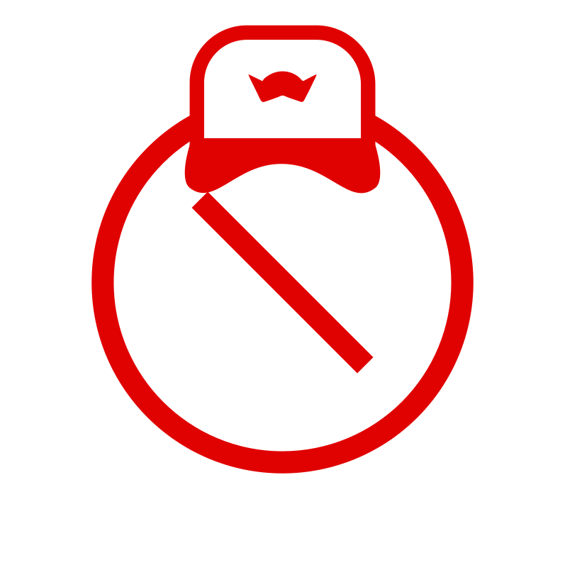

  

<h1 align="center">FredCentre Filter</h1>

> [!NOTE]
> Keep in mind that this filter is designed for FredCentre's work environment. Only use it if you know what you're doing.
## What does this do?
This filter basically blocks annoying elements on some specific websites that designed especially for FredCentre's work environment.

## Why am I making this?
Pasting the filter rules in every browser/extension is a hassle. I wanted to make a single filter that works across all browsers and extensions.

## How can I add this filter list to my browser/extension?
Get the link [here](https://raw.githubusercontent.com/FredCentre/FredCentreFilter/refs/heads/main/list.txt) and add it as a custom filter list in your browser/extension. FredCentre Filter works best with uBlock Origin and Brave Shields.

## Can I contribute?
No! I don't accept contributions. Only me can make changes to this filter list.
